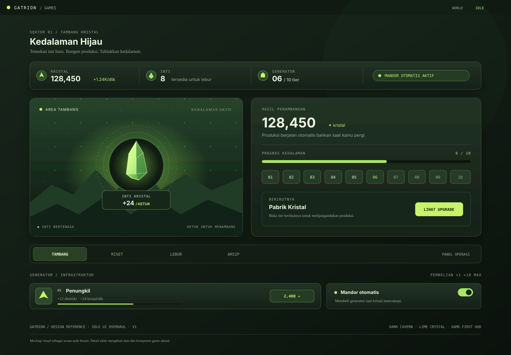

# Gatrion Idle UI Overhaul — Design Reference

This folder stores the visual reference and implementation notes for the idle-game UI overhaul.

## Mockup

Open the [SVG mockup](./idle-game-ui-overhaul.svg) directly for the full-size 1440 × 1000 design reference.

## Visual direction

- **Mood:** dark fantasy mining cavern, more like a game HUD than an admin dashboard.
- **Palette:** deep forest greens, stone-like panels, luminous lime crystal accents, restrained warm highlights.
- **Primary focus:** the crystal-mining interaction is presented as a distinct scene with layered cavern silhouettes, orbit rings, glow, and click feedback.
- **HUD:** resource totals and production rates are prominent; tier progress and the next unlock are easy to scan.
- **Generator cards:** item-like cards with clear ownership, production, milestones, progress, and costs.
- **Responsive behavior:** retain a compact, readable layout on mobile; keep the mining scene as the visual anchor.

## Implementation scope

Current branch: `feat/idle-game-ui-overhaul`

Initial implementation files:
- `src/games/idle/components/ClickPad.tsx`
- `src/styles/theme.css`

The mockup is a visual target, not a pixel-perfect rendering of live data. Existing economy, save format, idle production, auto-buy, research, prestige, and offline progress should remain intact while the UI is refined.

## Validation checklist

- [ ] Run `npm run build`
- [ ] Run `npm test`
- [ ] Check desktop and mobile layouts in a browser
- [ ] Verify crystal click feedback and generator purchase states
- [ ] Check all idle tabs: Tambang, Riset, Lebur, Arsip
- [ ] Confirm other mini-games are unaffected by the scoped theme
